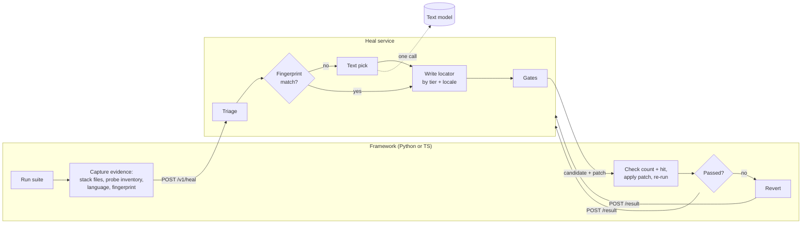

# Heal Service Spec

Status: approved for phase 1, 2026-11-05.

## Summary

Build one standalone heal service that both `playwright-ai-framework` (Python) and `playwright-ai-framework-ts` (TypeScript) call over HTTP. The service owns the model calls and the healing rules. The frameworks carry no model code. They send evidence plus the source files involved, apply the patch that comes back, and re-run.

- **Service does:** finds the broken call in the page object or test, builds the prompt, calls the model, picks the target element, writes the new locator by the priority rules, adds language branches, runs the gates, returns a patch, and decides healed or needs-human.
- **Frameworks keep:** running the tests, capturing page evidence, sending the source files in the failing call stack, applying the returned patch, re-running to verify, reverting, and opening the PR. No prompts, no model settings, no parsing of model output.
- **New option:** image + overlay. The client sends a screenshot and the element list with boxes. The service draws numbered marks on the screenshot and asks a vision model which mark is the target.
- **Why a service:** one healer, one set of rules, both languages get the same decision for the same evidence. The service never opens the app under test and never holds a checkout. It sees only the files the client sends and edits nothing on disk.

## What the frameworks do today

Both frameworks have an out-of-band heal CLI that does the whole job in one script, plus the Python framework has an older in-run healer. Checked line by line on 2026-11-05 against Python `main` at `53c3e83` and TS branch `fix/copilot-review-findings` at `a9389e2`.

| Piece | Python | TypeScript | Moves to service? |
| --- | --- | --- | --- |
| Run suite, collect failures | `scripts/heal.py`: pytest with JUnit XML, --reruns 0 | `scripts/heal.mjs`: Playwright JSON reporter, chromium project only, --retries=0 | No |
| Pull broken locator from the error | regex on the message; keeps only the first string argument (the selector), not the whole call | balanced-paren parse of `waiting for` / `Locator:` | Yes (service parses the error) |
| Find the one source call | literal `page.locator('…')` or self.page.locator('…') in \*.py under pages/tests/utils; get\_by\_\* calls are never matched; more than one match = refuse | `page.` / `this.page.` `locator()`/`getBy*()` calls in git-tracked `.ts` under `pages/tests/utils/fixtures`, quote- and whitespace-normalized; prefers the error's file:line, else the only match; ambiguous = refuse | Yes (client sends the files; service finds the call) |
| Page evidence | fresh Chromium (optional HEAL\_STORAGE\_STATE), aria snapshot of the route in the file's self.url (default /): the page as first loaded, not as it was at the failure | error-context snapshot taken at the failure, first 12,000 chars; none captured = refuse | Client captures; service consumes |
| Prompt + model call | OpenAI-style `HEAL_BASE_URL` / `HEAL_MODEL` / `HEAL_API_KEY`; temperature 0, max\_tokens 200, 180 s timeout; token usage not recorded | same env vars and settings, but no timeout | **Yes** |
| Model writes the locator string | yes, first line after stripping code fences | yes, first line, trailing semicolon dropped | **Replaced:** model picks an element; service writes the locator |
| Validate model output | AST check: a chain of approved methods (first/last/nth/filter allowed), literal args, same receiver | `heal-validate.mjs`: exactly one locator method call (chains such as .first() rejected); string, regex, number or flat-object args; same receiver | **Yes** (kept client-side as a second check) |
| Locator priority, locale, uniqueness, wrong-element checks | prompt asks for semantic locators; nothing checks it | prompt asks for semantic locators; nothing checks it | **New, in service** |
| Apply, re-run, revert on fail | span replace; re-run with -k on the test name; passes only if that exact test ran and passed and pytest exited 0 | position replace; re-run with --grep on the escaped title; healed if no failure has that title (does not check the test ran) | Service writes the patch; client applies, re-runs, reverts |
| `--open-pr` | branch heal/\<date>-\<id>, commits only healed files, pushes, gh pr create; clean-tree check ignores untracked files | same; clean-tree check counts untracked files | No |
| In-run healer | `utils/ai_healing.py` + `conftest.py`: Ollama only, runs on every failing test, screenshot + up to 5,000 DOM chars, writes an analysis report and a rewritten test file | Playwright Test Agents (healer markdown + MCP) | Python in-run path calls the service in advise mode (phase 4) |

The gap the service closes: today the model writes free-form locator text from a snapshot, with no ranking, no language handling, no check that the new locator hits one element, and no check that it is the same element the test used before.

Gaps in today's scripts that the service should not copy:

- TS drops failures past --max with no decision; Python records them as needs-human.
- TS counts a heal as good when the re-run shows no failure with that title, even if the test did not run.
- Python only finds .locator('…') calls, so a broken get\_by\_\* locator always goes to a human.
- Python snapshots the route as first loaded, so an element that only appears after a click or login step can be missing.
- Python crashes the whole run on a model error reply (KeyError on choices) or a timeout; TS turns an error reply into "no usable replacement".
- The two validators disagree: Python accepts chains such as .first(), TS rejects them.

## Architecture

The framework and the service exchange evidence and patches. Only the service reaches a model, and only for the one step code can't settle.



The request carries the evidence and the stack files. The service returns a patch. The framework sends back the re-run result, and a failed result moves the service to its next candidate. A fingerprint match goes straight to Write the locator with no model call.

| Touches | Framework | Service |
| --- | --- | --- |
| Browser and app under test | yes | never |
| Repo files on disk | reads stack files, applies patches | sees copies only, writes nothing |
| Git and PR | yes | never |
| Model endpoints and keys | never | yes |
| Locator rules, locale, gates | local validator as a second check | yes |

## API

HTTP + JSON, versioned under `/v1`. One heal is a short conversation: the client asks, applies the answer, reports the re-run, and gets either a final decision or the next candidate.

| Method | Path | Purpose |
| --- | --- | --- |
| GET | `/healthz` | Liveness |
| GET | `/v1/capabilities` | Service version, models per role, vision on/off, limits, supported client languages |
| GET | `/v1/probe.js` | The in-page script both clients run to build the element inventory (one copy, served, so Python and TS collect the same data) |
| POST | `/v1/heal` | Start a heal. Returns a decision or a candidate to try |
| POST | `/v1/heals/{heal_id}/result` | Client reports what the candidate did on re-run. Returns the next candidate or the final decision |
| GET | `/v1/heals/{heal_id}` | Audit record: evidence summary, model calls, gates, outcome |
| GET | `/v1/heals/{heal_id}/overlay.png` | The marked screenshot the vision model saw (vision mode only) |
| POST | `/v1/audit` | Phase 4. Rank existing locators against an inventory, no model call |

### `POST /v1/heal` request

```json
{
  "client": {"framework": "playwright-ai-framework", "language": "python", "version": "2.1.0"},
  "test": {"id": "tests/test_login.py::test_valid_login", "title": "valid login"},
  "failure": {
    "error": "Timeout 30000ms exceeded. waiting for locator('#username')",
    "stack": [
      {"file": "pages/login_page.py", "line": 18},
      {"file": "tests/test_login.py", "line": 9}
    ]
  },
  "source": {
    "roots": ["pages", "tests", "utils"],
    "files": [
      {"path": "pages/login_page.py", "sha256": "9f2c…", "content": "class LoginPage: ..."},
      {"path": "tests/test_login.py", "sha256": "41ab…", "content": "def test_valid_login(...): ..."}
    ]
  },
  "page": {
    "url": "https://app.example/login",
    "language": {"html_lang": "fr-CA", "browser_locale": "en-US", "content_language": null},
    "aria_snapshot": "- textbox \"Nom d'utilisateur\" ...",
    "inventory": [
      {"ref": "e7", "tag": "input", "role": "textbox", "name": "Nom d'utilisateur",
       "attrs": {"data-testid": "login-user", "id": "user", "name": "user", "type": "text"},
       "label": "Nom d'utilisateur", "placeholder": null, "text": null,
       "box": {"x": 412, "y": 220, "w": 280, "h": 36}, "visible": true, "enabled": true,
       "frame": null, "shadow_host": null}
    ],
    "viewport": {"w": 1280, "h": 720, "dpr": 1},
    "screenshot": null
  },
  "last_pass": {"fingerprint": {"role": "textbox", "name": "Username", "attrs": {"id": "username"}, "box": {"x": 410, "y": 218, "w": 280, "h": 36}}, "language": "en"},
  "options": {"vision": "auto", "max_rounds": 3, "locale_branching": true}
}
```

`source.files` holds only the files named in the failing call stack that sit under `source.roots`, so the page-object file always rides along when a page-object method failed. Caps: 20 files, 256 KB each. The service parses them (Python `ast`, TypeScript via a TS parser), finds the one broken call, and sees every other use of that locator, so one page-object fix covers every test that shares it.

- `page.screenshot` is `{"png_base64": "…"}` when vision is allowed, else `null`. Masked fields (passwords, anything the client marks) are blacked out by the client before sending.
- `last_pass` is optional. When present, the service can reject a candidate that lands on a different element than the passing run used.
- Input `value` attributes are never sent. The service refuses a request that carries any.

### Response: a candidate or a decision

```json
{
  "heal_id": "h_01J…",
  "status": "try",
  "candidate": {
    "target_ref": "e7",
    "strategy": "test_id",
    "locator": {"kind": "test_id", "value": "login-user"},
    "code": "self.page.get_by_test_id('login-user')",
    "branches": null,
    "expect": {"count": 1, "ref": "e7"},
    "patch": {
      "file": "pages/login_page.py",
      "base_sha256": "9f2c…",
      "span": {"start": 512, "end": 541},
      "from": "self.page.locator('#username')",
      "to": "self.page.get_by_test_id('login-user')",
      "diff": "--- a/pages/login_page.py\n+++ b/pages/login_page.py\n@@ …"
    },
    "why": "Same textbox the passing run used (role, position); test id outranks the old id."
  },
  "round": 1
}
```

- `status` is one of `try`, `healed`, `needs_human`, `not_drift`.
- `code` is rendered for the client's language. `locator` is the language-neutral form, so a client can render it itself and compare.
- `branches` is filled when the locator depends on page copy and the page language differs from the passing run's (see Heal pipeline).
- `needs_human` and `not_drift` carry a `why` the client prints and puts in the PR body, as today.

### `POST /v1/heals/{heal_id}/result`

```json
{"count": 1, "hit": {"ref": "e7"}, "test_outcome": "passed", "error": null}
```

Before it edits anything, the client checks the candidate in the live page: `count` must be 1 and the hit must be `expect.ref`. Then it applies `patch` only if all of these hold: the file's current hash equals `base_sha256`, the file is under `source.roots`, the span holds exactly `from`, and `to` passes the framework's existing locator validator (`validate_replacement` / `validReplacement`). It re-runs the exact test and reports. A count other than 1, a different element, or a failed re-run makes the client revert and the service move to the next candidate, up to `max_rounds`, then `needs_human`.

## Heal pipeline and gates

Each heal climbs a cost ladder and stops at the first step that settles it. A model is called only when code can't decide, and the model picks an element from a short list. It never writes locator text.

1. **Triage (no model).** Parse the error. No locator in it means `not_drift`. Find the broken call in the sent files. Zero matches, or several with no stack line to tell them apart, means `needs_human`. These are the same rules the clients use today, moved into the service.
2. **Same-element match (no model).** When `last_pass` is present, score inventory elements against the passing fingerprint: test id, id, name, role + accessible name, box position. Exactly one strong match settles the target with no model call. How often this settles a heal is unmeasured. It works when only one or two attributes changed, such as a renamed id. A redesign that changes label, markup and position together leaves no single strong match, and the heal goes on to step 3. The testbed run reports the share settled here.
3. **Text pick (text model, 1 call).** Pre-filter the inventory to elements the old locator could have meant, by compatible role or tag and by the action the test runs on it (fill, click, check). Cap the list at 30 lines. The model gets the broken line plus 3 lines around it, the page language, and that list. It answers `{"ref": "e7", "why": "…"}`. A ref not on the list is refused.
4. **Vision pick (vision model, 1 call, optional).** Runs only when step 3 returns no pick or two close picks, and only if vision is allowed. See Vision mode.
5. **Write the locator (no model).** From the chosen element, the service builds the highest-ranked locator that is unique on the page: test id (`data-testid`, `data-test`, `data-qa`, `data-cy`) > hand-written id > `name` > CSS on a non-copy attribute > role + name > label > placeholder > text > structural or positional. Generated ids (hash-like, numeric runs) don't count as hand-written. A heal never moves down a tier from the broken locator unless nothing higher is unique, and the decision says when it had to.
6. **Locale (no model).** When the new locator depends on page copy (role + name, label, placeholder, text), it is never translated into another language. When the page language differs from `last_pass.language`, the service returns `branches`, for example `{"fr": …, "en": …}`, and code that switches on the page language. The page language is detected from `<html lang>`, then the browser locale, then `Content-Language`, never from words on the page. If a non-copy locator is unique, it wins and no branch is needed.
7. **Verify (client, no model).** The client checks count = 1 and that the hit is the chosen element, applies the patch, and re-runs the exact test. A failure moves to the next ranked locator for the same element (no model call). Only a wrong-element result goes back to steps 3–4.

### Token budget

The defaults below are starting points, to be tuned against measured usage on the testbed.

| Control | Default | What it stops |
| --- | --- | --- |
| Model never sees source files | the service reads them; the prompt gets the broken line + 3 lines | whole-file prompts |
| Model never sees DOM or full aria snapshot | prompt gets the filtered list only, one line per element | DOM dumps (today's in-run healer sends up to 5,000 DOM characters) |
| Candidate list cap | 30 lines | big pages blowing the prompt |
| Output cap | 64 tokens, thinking off | long answers and reasoning chatter |
| Model calls per heal | 2 (one text, one vision) | retry loops |
| Images per heal | 1, cropped to the candidates' area and downscaled to 1024 px on the long side | full-page images |
| Per-run budget | `HEAL_RUN_TOKEN_BUDGET`; when it's spent, remaining failures go to `needs_human` with that reason | a broken release triggering hundreds of model calls |
| Shared-locator dedup | one heal per broken page-object call per run; every test that uses it gets that result | the same locator healed once per test |
| Decision cache | key = broken call + inventory hash + language; a hit costs 0 tokens | re-healing the same drift on the next run |
| Local first | cloud models are opt-in per role | paid tokens by default |

Every response carries `usage` (calls, input and output tokens, images, by role and model), and the client prints a run total. A heal settled at step 1, 2, 5, 6 or 7 shows 0 tokens.

## Vision mode (image + overlay)

Vision is an option, off by default and `auto` when turned on. The client sends one raw screenshot. The service draws the overlay, so both languages produce identical marked images and the clients need no drawing code.

- **Modes:** `off` sends no image bytes and the client skips the screenshot entirely. `auto` captures the screenshot but the service uses it only when the text pick fails or is a close call. `on` uses vision for every heal that reaches step 3 (testing and evaluation, not daily runs).
- **Capture (client):** a viewport screenshot through Playwright, with `mask` on password inputs and on any locators the project lists in a `HEAL_MASK` setting. No full-page shots, because a late scroll restore can shift the page under a click.
- **Overlay (service):** a numbered box drawn on each pre-filtered candidate from its inventory `box`, with the number equal to the candidate's list position. Then a crop to the candidates' area plus a margin, and a downscale. Off-screen candidates are listed in text and marked "not visible".
- **Prompt:** the marked image, the same short candidate list as the text pick, and the broken line. The model answers with a mark number. A number not on the list is refused.
- **Use:** the chosen mark maps back to an inventory `ref`, then steps 5–7 run unchanged. Vision only helps pick the element. It never writes a locator.
- **Evidence:** the marked image is kept with the heal record (`/overlay.png`) and linked from the PR body, so a reviewer sees what the model saw.
- **Egress:** an image goes only to a model whose role config has `images_allowed=true`. A cloud vision model needs that set explicitly.

## Model config (service only)

All model settings live in the service's environment. The frameworks never see them. There are two roles, each pointed at any OpenAI-compatible or Anthropic endpoint, local or cloud.

| Variable | Example | Notes |
| --- | --- | --- |
| `HEAL_TEXT_BASE_URL` / `HEAL_TEXT_MODEL` / `HEAL_TEXT_API_KEY` | `http://localhost:11434/v1`, `qwen3:8b` | Text pick. Key optional for a local server |
| `HEAL_TEXT_PROVIDER` | `openai` \| `anthropic` | Wire format |
| `HEAL_VISION_BASE_URL` / `_MODEL` / `_API_KEY` / `_PROVIDER` | a local vision model | Unset = vision unavailable, and `auto`/`on` fall back to text |
| `HEAL_VISION_IMAGES_ALLOWED` | `true` | Must be set before any image leaves the service |
| `HEAL_BASE_URL` / `HEAL_MODEL` / `HEAL_API_KEY` | today's names | Fallback for the text role, so existing setups keep working |
| `HEAL_MAX_CALLS`, `HEAL_MAX_OUTPUT_TOKENS`, `HEAL_CANDIDATE_CAP`, `HEAL_RUN_TOKEN_BUDGET` | `2`, `64`, `30`, unset | Token budget controls |
| `HEAL_THINKING` | `off` | Reasoning off unless asked for |
| `HEAL_TIMEOUT_S` | `120` | Per model call |

If the operator routes through a gateway or proxy, they point `*_BASE_URL` at it. The service adds `X-Heal-Caller` and `X-Heal-Id` headers so a gateway can attribute cost per heal.

## Client integration

Each framework gets a small client that knows HTTP, the browser and git, and nothing about models. The CLI flags people use today stay the same.

|  | Python (`playwright-ai-framework`) | TypeScript (`playwright-ai-framework-ts`) |
| --- | --- | --- |
| Entry point | `scripts/heal.py` (same flags: `-k`, `--max`, `--open-pr`) | `scripts/heal.mjs` (same flags: `--grep`, `--max`, `--open-pr`) |
| New module | `utils/heal_client.py`: request building, probe, screenshot, patch apply | `scripts/heal-client.mjs`: same |
| Removed | `propose_replacement` and its prompt; the model env vars | `proposeReplacement` and its prompt; the model env vars |
| Kept | test runner, JUnit parse, `verify_passed`, revert, PR flow, `validate_replacement` as a second check | JSON reporter parse, re-run by title, revert, PR flow, `validReplacement` as a second check |
| Page evidence | reopen the failing route with `HEAL_STORAGE_STATE`, run `/v1/probe.js`, read the aria snapshot | the failure-time error-context snapshot, plus a probe run against the reopened route |
| Pass fingerprints | a pytest plugin records the fingerprint of each locator a passing test touches into `.heal/fingerprints.json` | a fixture does the same into the same file format |
| Config | `HEAL_SERVICE_URL`, `HEAL_SERVICE_TOKEN`, `HEAL_VISION` (off \| auto \| on), `HEAL_MASK` | same names |

The fingerprint file is what makes step 2 of the pipeline (the no-model same-element match) possible. Without it, every heal starts at the text pick. It holds element attributes and boxes only, never input values, screenshots or HTML.

The fingerprint file is not committed by default. The client writes `.heal/.gitignore` containing `*`, writes fingerprints only from a clean green run (no retries, not flaky, not healed), and CI keeps `.heal/` as a cache from the last green run on the default branch. Committing it is an opt-in setting. Fingerprints change with app versions and viewport size, so a committed file would churn and conflict; a first failure with no fingerprint simply skips step 2.

A run's flow, the same in both languages:

1. Run the suite and collect failures.
2. Per failure, gather the stack files, the probe inventory, the language signals, the fingerprint and, if vision is on, a masked screenshot. Then `POST /v1/heal`.
3. On `try`: check count and hit in the page, apply the patch, re-run, then `POST /result`. Repeat until the answer is `healed`, `needs_human` or `not_drift`.
4. Print decisions with token usage. With `--open-pr`, commit only the healed files, as today.

### Other ways in

- **CLI:** `heal-service serve` runs the HTTP service. `heal-service heal --request req.json` runs one heal offline from a saved request, which is useful for replays and tests.
- **MCP:** the service also exposes `heal_locator` and `audit_locators` as MCP tools on the same core. Playwright's own Test Agents healer, which the TS framework uses, can call those tools instead of guessing locators.
- **In-run advise (Python, phase 4):** `conftest.py` posts the failure in `advise` mode. The service returns the decision without a patch, and it goes into the existing healing report. This replaces the Ollama-only `utils/ai_healing.py` path.

## Metrics and dashboard

Every heal writes one record, and every number on the dashboard drills down to the records behind it. If it isn't measured, it didn't happen: the service counts a heal as healed only with a recorded verify (count = 1, right element, exact test re-run passed), and every claim in a PR body or run summary is one of the numbers below. The headline measure is value: heals a human kept and that stayed green, not heals attempted.

### The heal record

One row per heal in the audit store, with these fields:

- **Where:** run id, repo, framework and language, test id, file and line, page URL path, page language.
- **What broke:** the broken locator and its tier.
- **How it ended:** outcome, `needs_human` reason code, the step that settled it (1–7), rounds, candidates tried, candidates rejected for hitting the wrong element.
- **What it wrote:** the final locator and its tier, tier movement (up, same, down), whether a language branch was added, and how many tests the fix covered (shared page-object dedup).
- **Cost:** per model call, the role, model, local or cloud, input and output tokens, images and latency. Also cache hit or miss, and whether the budget ran out.
- **After the PR:** merged unchanged, edited, or reverted by a human. Whether the healed locator failed again in later runs, and after how many. The client reports these on its next run.

### What the dashboard shows

Headline numbers, at the top of the dashboard and printed at the end of every run:

| Number | Definition |
| --- | --- |
| Failures seen | Failing tests the client sent to the service |
| Locator drift | Failures the service classed as drift (not `not_drift`) |
| Success rate | `healed` ÷ locator drift |
| Fail rate | `needs_human` ÷ locator drift, split by reason |
| Tests fixed | Tests that failed before and pass after, counting every test a shared page-object fix covers |
| Locators fixed | Distinct source locators changed |
| Model calls | Total calls, and calls per fixed test |
| Calls that led to a fix | Calls whose pick became a kept heal ÷ all calls; the rest is spend with no result |
| Tokens and cost per fix | Tokens (and cost, when the operator sets a price per model) ÷ tests fixed |
| Kept rate | Heals merged unchanged ÷ heals proposed (after the PR closes) |

The detail behind those numbers:

| Metric | Question it answers | Drills to |
| --- | --- | --- |
| Kept-heal rate | Of the heals proposed, how many did a human merge unchanged? | each heal with its PR state |
| Durability | Do healed locators still pass 10 runs and 30 days later? | heals that broke again, with the new failure |
| Escaped wrong heals | Did any heal land on the wrong element and get through? Target: 0 | each reverted or edited heal, with its overlay |
| Wrong-element catches | How often did verify stop a wrong pick before it reached the PR? | the rejected candidates per heal |
| Outcome mix per run | healed, needs-human, not-drift, over time | the run's decision list |
| Settled-at-step | How often each step (fingerprint, text, vision…) settles a heal. Measures the claim corrected above | heals per step |
| Needs-human reasons | Top causes: target missing from the page, ambiguous source, budget spent, model gave no usable pick | the heals per reason |
| Locator tier movement | Are heals moving locators up toward test ids, or down toward text? | heals per movement |
| Hot spots | Which page objects and locators break most often (candidates for test ids in the app) | the heal history per locator |
| Cost | Tokens per run and per kept heal, by role and model; local vs cloud share; budget-exhausted runs | the model calls per heal |
| Latency | Time per heal and per step, model call time | the slowest heals |
| Vision effect | How often vision ran, and how often it changed the text pick for a kept heal | heals where vision ran |
| Language | Heals by page language, branches added | heals per language |

### How the data is exposed

- `GET /v1/metrics?repo=&from=&to=&framework=` returns aggregates as JSON.
- `GET /v1/heals?…` is the filtered list behind any aggregate, and each row links to `/v1/heals/{id}` and its overlay.
- `GET /metrics` serves Prometheus counters and histograms for anyone with Grafana.
- `GET /dashboard` is a built-in page reading the JSON API, with no extra service. Every tile links to its filtered heal list, and CSV export is on every list.
- **Per-run file:** each client writes `heal-summary.json` into its test artifacts and adds heal fields to the reporting it already has (the TS metrics JSONL `healEvent` field, the Python observability report), so heal results sit next to the test results.

## Security, privacy, deployment

The service is a pure function of what the client sends. It fetches no URLs, writes no source files, and runs no code it received.

- **Auth:** bearer token (`HEAL_SERVICE_TOKEN`). The service binds to `127.0.0.1` by default, and listening wider needs a flag plus a token.
- **Input limits:** 10 MB per request, 20 files, 256 KB per file, 500 inventory entries, one image. Anything over the limit is refused with 413, not truncated silently.
- **No secrets in:** the request is refused if it carries input `value`s or a cookie or storage dump. Password fields must be masked in the screenshot. The service never logs file contents or images, and log lines hold the heal id, the outcome and usage.
- **Untrusted model output:** the reply is parsed as JSON against a schema and must name a ref or mark from the list. Locator text is built by the service, never taken from the model. Source files are parsed, never imported or run (no `eval`, no dynamic import).
- **Untrusted page content:** page copy and attributes reach the prompt only inside the quoted candidate list, length-capped per field. A page that says "ignore your instructions" can only change which element looks right, and steps 5–7 still check the result.
- **Patch safety:** the client applies only span replacements whose base hash matches, under `source.roots`, that change one locator expression and pass the local validator. Anything else is rejected client-side.
- **Audit store:** SQLite, decisions + usage + overlay images. Retention defaults to 14 days (`HEAL_RETENTION_DAYS`), and `0` keeps nothing.
- **Packaging:** Python 3.12 + FastAPI. Shipped as a pip package (`heal-service`) and a Docker image. The service is stateless apart from the audit store, so it can run on a laptop next to the tests or as one shared instance for a team.
- **Public-repo hygiene:** no hostnames, IPs or keys in code, docs or examples. Examples use `localhost` and `app.example`.

## Testing and acceptance

A heal counts as done only when the re-run of the exact test passes on the same element. A green exit code alone is not enough.

- **Contract fixtures:** golden request and response JSON files in the service repo. Both clients' tests replay them and must render the same `locator` and the same decision. This is how Python and TS are held to the same behaviour.
- **Drift testbed:** a small static site with versions of one page: renamed id, removed test id, moved markup, label copy change, a French version, a checkbox turned into a switch, a duplicate button, and a target removed outright. Each version has an expected outcome (`healed` to a named element, or `needs_human`).
- **Run both frameworks' suites against the testbed** through the service, with vision off and then with `auto`.

Acceptance criteria:

- [ ] 0 wrong-element heals kept on the testbed, in either language
- [ ] Every `healed` decision has a passing re-run of the exact test and a count = 1 check on the chosen element
- [ ] Removed-target cases end `needs_human`, never a nearby element
- [ ] Copy locators are never translated; the French case yields a language branch
- [ ] No heal moves down a locator tier when a higher unique one exists
- [ ] With vision `off`, zero image bytes leave the client
- [ ] Python and TS give the same decision for every contract fixture
- [ ] Token usage is reported per heal and per run, including the share of heals settled at each step, measured on the testbed and on one real suite
- [ ] The frameworks contain no model URL, model name, prompt or model reply parsing

## Phases

1. **Service core + Python client:** the API, the pipeline in text mode, the fingerprint plugin, the heal record with /v1/metrics, contract fixtures, the testbed.
2. **TS client:** same fixtures, same testbed.
3. **Vision:** screenshot capture with masks, server-side overlay, `auto` mode.
4. **MCP, audit, in-run advise:** MCP tools, `/v1/audit`, the Python in-run path moved onto the service, the /dashboard page, and the post-PR signals (kept, durability).

Each phase ships as a PR to the repo it touches, reviewed before merge. Phases 1 and 2 are needed before the healer can be shared.

## Decisions and open questions

- **Decided:** the frameworks drop their direct model calls once the service client lands. No fallback to direct mode, so the frameworks stay LLM-unaware.
- **Decided (2026-11-05):** the service repo is `heal-service`. It starts private and goes public once it is tested, every file is commented, and its docs exist.
- **Decided (2026-11-05):** the service reuses the owner's earlier locator-healing code (locator parsing, locator ranking, uniqueness, element identity, model endpoints, the in-page probe and the drift testbed) instead of being rewritten from scratch.
- **Decided (2026-11-05):** the fingerprint file is not committed by default (see Client integration).
- **Decided (2026-11-05):** the client sends the project's test-id attribute (default `data-testid`), so `get_by_test_id` is only written when it matches what the project configures.
- **Decided (2026-11-05):** in phase 1, a heal whose only unique locator is structural or positional ends `needs_human` instead of writing one.
- **Open:** the license, chosen before the repo goes public.
- **Open:** one shared service instance for a team, or one per developer by default. The spec supports both. This only changes the docs and the default bind address.
